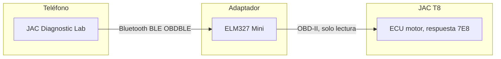
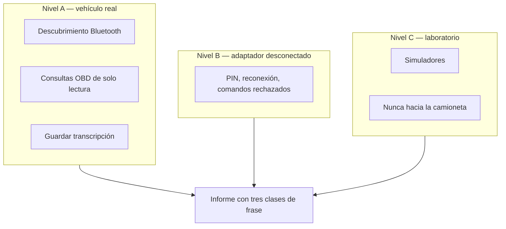

# JAC T8 — diagnóstico de solo lectura y evaluación de seguridad

Evaluación del **11 de noviembre de 2026** sobre una JAC T8 estacionada, con un ELM327 Mini Bluetooth y un Xiaomi. No es una certificación ISO/SAE 21434 ni UNECE R155. Es un procedimiento reproducible: medir, guardar la respuesta cruda y separar la falla técnica de la ciberseguridad.

**App actual: JAC Diagnostic Lab 1.11.1**, validada en la unidad el 2026-11-18 ([resultados](research/validation/2026-11-18-unidad-real.md): ECU Delphi DCM6.2, P0579 + P2299 persistentes). APK: [release v1.11.1](https://github.com/cherrera0001/jac-diagnostic-lab/releases/tag/v1.11.1). En 1.10.0: Nuevo: informe para el taller después de leer todo ([SPEC-033](specs/033-workshop-report/spec.md)). En 1.9.0: Nuevo: identificación de ECU Mode 09 y perfil JAC T8 con fuentes ([SPEC-031](specs/031-vehicle-fingerprint-profiles/spec.md), [research/](research/)). Última publicada: [release v1.8.0](https://github.com/cherrera0001/jac-diagnostic-lab/releases/tag/v1.8.0). Estado por sistema, escaneo de todos los PID declarados, Mode 06/09 y pruebas dinámicas. Issue abierto: **SAFE-001**.

El informe de la medición no se versiona. Queda solo en el equipo donde se generó.

## Cómo está armado



| Carpeta | Qué es |
|---|---|
| [jac-diagnostic-lab](jac-diagnostic-lab/) | Aplicación Android. Habla con el vehículo. |
| [c4a-automotive-security](c4a-automotive-security/) | Inventario, amenazas, hallazgos y el informe. No transmite al vehículo. |

La app solo envía una lista cerrada de consultas. No borra códigos, no reprograma y no mueve actuadores. Otra aplicación del teléfono sí podría hablar directo con el adaptador: el filtro vive en esta app, no en el dongle.

## Cómo se usa

Condición: camioneta **estacionada**, freno de mano puesto, motor en marcha o contacto en **ON**. Cerrar otras apps de diagnóstico: el adaptador atiende a un solo cliente.

1. Enchufar el adaptador bajo el volante. El emparejamiento se hace en Ajustes de Android; la app no pide ni guarda el PIN.
2. Abrir la app y pulsar **Conectar y diagnosticar**. Tarda cerca de un minuto.
3. Leer **Estado**: el veredicto, los códigos y los mosaicos por sistema. Un toque en un mosaico muestra los números en que se basa.
4. **En vivo** para ver los valores moverse; **Pruebas** para una prueba guiada.
5. **Informe** → PDF. Llevarlo al servicio de la marca y pedir que lean los mismos números sin borrarlos.

| Pestaña | Para qué sirve | Qué no hace |
|---|---|---|
| Estado | Veredicto, códigos con título corto, salud por sistema | No da porcentaje ni certifica la camioneta |
| En vivo | Medidores grandes con mini-gráfico | No inventa un PID de freno |
| Pruebas | Ralentí, calentamiento, aceleración libre, carga eléctrica, ruta/banco | No mueve nada: solo registra |
| Datos | Todas las señales, Mode 06, datos de la ECU | No muestra valores truncados como datos |
| Informe | PDF / JSON / TXT / CSV y herramientas avanzadas | No sube nada a internet |

El informe de una unidad concreta queda fuera de este repositorio.

## Proceso de funcionamiento

Cada ciclo tiene tres niveles. Solo el A toca la camioneta.



| Clase de frase | Cuándo se usa |
|---|---|
| Medido | Hay archivo de la sesión, con hora y respuesta cruda |
| Documental | Sale de un manual o de una norma, y se dice que no se midió en esta unidad |
| Desconocido | No hay archivo ni fuente aplicable a esta camioneta |

Reglas del ciclo:

1. Vehículo estacionado. Las pruebas en marcha solo en banco de rodillos o pista cerrada, con acompañante; nunca en la vía mientras SAFE-001 siga abierto.
2. Lista cerrada de comandos. `ATZ` reinicia el intérprete del adaptador. El servicio `04`, que borra códigos, está bloqueado.
3. `NO DATA` no significa “sin fallas”. Una conexión exitosa no autoriza a circular.
4. Los síntomas EPC y de potencia van a la línea técnica. No se llaman ciberataque sin una evidencia distinta.
5. El laboratorio de `c4a-automotive-security/lab/` no se conecta al transporte Bluetooth real.

Compilar y probar, desde `jac-diagnostic-lab`, con JDK 21:

```text
gradlew.bat :app:testDebugUnitTest :app:assembleDebug
```

Instalar la APK debug con el teléfono desbloqueado:

```text
adb install -r dist\jac-diagnostic-lab-1.11.1-debug.apk
```

## Cómo se construye

El trabajo nuevo entra por [specs/PROCESO.md](specs/PROCESO.md): requisito numerado, decisión en `adr/`, prueba que nombra el requisito, y después el código. La exportación está en [specs/001-exportacion/spec.md](specs/001-exportacion/spec.md) y [ADR-001](adr/ADR-001-el-archivo-se-arma-al-pulsar.md).

## Versión

La serie de cambios de software está en [CHANGELOG.md](CHANGELOG.md). La app informa `versionName` 1.11.1 (`versionCode` 26). Los resultados de una unidad concreta no forman parte de este archivo.

## Licencia y uso

El código es de acceso libre bajo [Apache-2.0](LICENSE): se puede usar, copiar, modificar y redistribuir, también con fines comerciales, conservando la licencia y el [NOTICE](NOTICE). Se entrega sin garantía. Las reglas para contribuir y los datos que nunca se suben están en [CONTRIBUTING.md](CONTRIBUTING.md).
