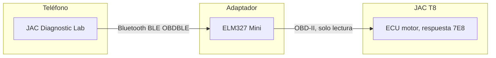
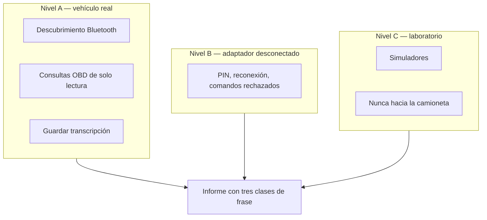

# JAC T8 — diagnóstico de solo lectura y evaluación de seguridad

Evaluación del **11 de noviembre de 2026** sobre una JAC T8 estacionada, con un ELM327 Mini Bluetooth y un Xiaomi. No es una certificación ISO/SAE 21434 ni UNECE R155. Es un procedimiento reproducible: medir, guardar la respuesta cruda y separar la falla técnica de la ciberseguridad.

**App actual: JAC Diagnostic Lab 1.19.0** (`versionCode` 36), compilada, probada (`:app:testDebugUnitTest`, `:app:lintDebug`, `:app:assembleDebug`) e instalada en Xiaomi `2512BPNDAG` el 2026-11-22 (base validada en la unidad el 2026-11-18: [resultados](research/validation/2026-11-18-unidad-real.md), ECU Delphi DCM6.2, P0579 + P2299 persistentes). APK: [release v1.19.0](https://github.com/cherrera0001/jac-diagnostic-lab/releases/tag/v1.19.0) (`jac-diagnostic-lab/dist/jac-diagnostic-lab-1.19.0-debug.apk`). Incluye SPEC-034 R7–R11: **estimación de combustible sin mirar el tablero** (`PID 0x2F` o integración `0x5E`/MAF `0x10` desde «Estanque lleno», siempre etiquetada `ESTIMACIÓN/INFERENCIA`), **captura continua en segundo plano** (`ForegroundService` con notificación persistente viva con pantalla apagada o usando otra app), **soporte nativo de Android Auto** (tablero horizontal 3×2 en solo lectura compatible con Spotify y Waze/Maps), **Perfil de Captura Rápida de Falla** (Set Crítico de 8 PIDs: `0x49, 0x4A, 0x04, 0x62, 0x0C, 0x0D, 0x23, 0x42`), **Diagnóstico Diferencial** en informe PDF (hechos observables vs. hipótesis: corte de torque *brake override* frente a apagado total por riel `0x23` o tensión `0x42`, con recomendación automática del Set Crítico), guía de cambios 6M diésel, bóveda privada + `.jacenc`, «Borrar y limpiar» con compuerta Mode 04 y pestaña **Señales**. Issue abierto: **#1 (`SAFE-001`)**.

El informe de la medición no se versiona. Queda solo en el equipo donde se generó.

## Cómo está armado



| Carpeta | Qué es |
|---|---|
| [jac-diagnostic-lab](jac-diagnostic-lab/) | Aplicación Android. Habla con el vehículo. |
| [c4a-automotive-security](c4a-automotive-security/) | Inventario, amenazas, hallazgos y el informe. No transmite al vehículo. |

La app solo envía una lista cerrada de consultas. Solo lee; la única escritura es «Borrar y limpiar» (Mode 04 con vehículo detenido, más sesión nueva desde cero). No reprograma y no mueve actuadores. Otra aplicación del teléfono sí podría hablar directo con el adaptador: el filtro vive en esta app, no en el dongle.

## Cómo se usa

Condición: camioneta **estacionada**, freno de mano puesto, motor en marcha o contacto en **ON**. Cerrar otras apps de diagnóstico: el adaptador atiende a un solo cliente.

1. Enchufar el adaptador bajo el volante. El emparejamiento se hace en Ajustes de Android; la app no pide ni guarda el PIN.
2. Abrir la app y pulsar **Conectar y diagnosticar**. Tarda cerca de un minuto.
3. Leer **Estado**: el veredicto, los códigos y los mosaicos por sistema. Un toque en un mosaico muestra los números en que se basa.
4. **En vivo** para ver los valores moverse; **Pruebas** para una prueba guiada.
5. **Informe** → PDF. Llevarlo al servicio de la marca y pedir que lean los mismos números sin borrarlos.

| Pestaña / Modo | Para qué sirve (qué hace cada función) | Qué no hace |
|---|---|---|
| **Estado** | Veredicto en una línea, códigos DTC (guardados/pendientes) tocables con detalle técnico y mosaicos de salud por sistema (motor, combustible, turbo, DPF, batería) | No da porcentaje global ni certifica aptitud para circular |
| **En vivo** | Medidores grandes en tiempo real, **Captura rápida de falla (Set Crítico de 8 PIDs: `0x49, 0x4A, 0x04, 0x62, 0x0C, 0x0D, 0x23, 0x42`)**, **estimación de combustible (`ESTIMACIÓN/INFERENCIA` R7)** con botón «Estanque lleno», **captura continua en segundo plano** (`ForegroundService` R8) y **Modo Tablero manos libres** con guía de cambio 6M diésel | No inventa PIDs de freno, no presenta litros estimados como medición directa ni mide sensores internos de la caja |
| **Android Auto** | Tablero horizontal 3×2 pausado (refresco 1,2 s, solo lectura) directo en la pantalla OEM de la JAC T8: Motor/Cambio, Refrigerante real, Batería ECU, Turbo/Riel, DPF/Regeneración («No apagar») y Estado/DTC, más vistas de detalle (incl. combustible estimado R7) y «Marcar evento». Convive sin cortes con Spotify y Waze/Maps (categoría `IOT`, sin foco de audio) | No modifica el firmware Linux de la radio ni borra códigos desde la pantalla del auto |
| **Pruebas** | Pruebas guiadas estacionarias (ralentí, calentamiento, aceleración libre, carga eléctrica, freno vs acelerador), **Captura rápida de falla (8 PIDs)** y registro en ruta/banco con **forense de paros (`EventForensics`)** y CSV | No mueve actuadores ni acelera/frena el vehículo |
| **Datos** | Catálogo completo de señales leídas con buscador, Mode 06 (autopruebas ECU), Mode 09 (CALID, CVN, VIN), horas de motor y km desde borrado | No muestra ceros o tramas truncadas como datos válidos |
| **Señales** | Hub de 3 sub-vistas: **BLE / Tags** (categorías reales, identificación activa opcional GATT/IETF DULT, apodos, flecha orientativa por calibración espacial silenciosa o giro con brújula y exportación GeoJSON/GPX), **Redes y RF** (canales Wi-Fi 2,4/5/6 GHz y Evil Twin, celdas 4G/5G con MHz reales y SINR, satélites GNSS, FFT magnético en vivo) y **Seguridad** (Escudo defensivo automático + reporte JSON) | No sintoniza 315/433 MHz sin RTL-SDR ni accede a cuentas nube de Apple/Google |
| **Informe** | Genera PDF profesional con sello vectorial `C4A · c4a.cl`, **Diagnóstico Diferencial** (Hechos observables vs. Hipótesis: corte de torque *brake override* frente a apagado total por riel `0x23`/tensión `0x42`) y recomendación automática del Set Crítico de 8 PIDs, huella SHA-256, JSON/TXT/CSV, copia en bóveda privada (`filesDir/vault/`), exportación cifrada AES-256-GCM (`.jacenc`) y «Borrar y limpiar» (Mode `04` detrás de `ClearDtcGate`) | No sube ningún dato a internet (`allowBackup=false`) |

El informe de una unidad concreta queda fuera de este repositorio.

## Proceso de funcionamiento

Cada ciclo tiene tres niveles. Solo el A toca la camioneta.



| Clase de frase | Cuándo se usa |
|---|---|
| Medido | Hay archivo de la sesión, con hora y respuesta cruda |
| Documental | Sale de un manual o de una norma, y se dice que no se midió en esta unidad |
| Desconocido | No hay archivo ni fuente aplicable a esta camioneta |

Reglas del ciclo:

1. Vehículo estacionado. Las pruebas en marcha solo en banco de rodillos o pista cerrada, con acompañante; nunca en la vía mientras SAFE-001 siga abierto.
2. Lista cerrada de comandos. `ATZ` reinicia el intérprete del adaptador. La única escritura permitida es `04` dentro de «Borrar y limpiar» (`ClearDtcGate`: vehículo detenido + respaldo privado automático previo); UDS de escritura, calibraciones y actuadores siguen bloqueados.
3. `NO DATA` no significa “sin fallas”. Una conexión exitosa no autoriza a circular.
4. Los síntomas EPC y de potencia van a la línea técnica. No se llaman ciberataque sin una evidencia distinta.
5. El laboratorio de `c4a-automotive-security/lab/` no se conecta al transporte Bluetooth real.

Compilar y probar, desde `jac-diagnostic-lab`, con JDK 21:

```text
gradlew.bat :app:testDebugUnitTest :app:assembleDebug
```

Instalar la APK debug con el teléfono desbloqueado:

```text
adb install -r dist\jac-diagnostic-lab-1.19.0-debug.apk
```

## Cómo se construye

El trabajo nuevo entra por [specs/PROCESO.md](specs/PROCESO.md): requisito numerado, decisión en `adr/`, prueba que nombra el requisito, y después el código. La exportación está en [specs/001-exportacion/spec.md](specs/001-exportacion/spec.md) y [ADR-001](adr/ADR-001-el-archivo-se-arma-al-pulsar.md). El motor de evidencia y las capacidades recientes (`R1`–`R11`) viven en [specs/034-evidence-engine-mvp/spec.md](specs/034-evidence-engine-mvp/spec.md).

## Versión

La serie de cambios de software está en [CHANGELOG.md](CHANGELOG.md). La app informa `versionName` 1.19.0 (`versionCode` 36). Los resultados de una unidad concreta no forman parte de este archivo.

## Licencia y uso

El código es de acceso libre bajo [Apache-2.0](LICENSE): se puede usar, copiar, modificar y redistribuir, también con fines comerciales, conservando la licencia y el [NOTICE](NOTICE). Se entrega sin garantía. Las reglas para contribuir y los datos que nunca se suben están en [CONTRIBUTING.md](CONTRIBUTING.md).
