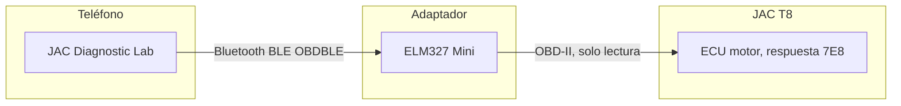
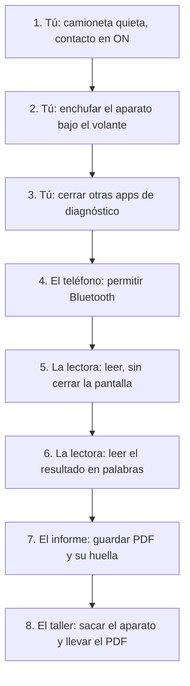
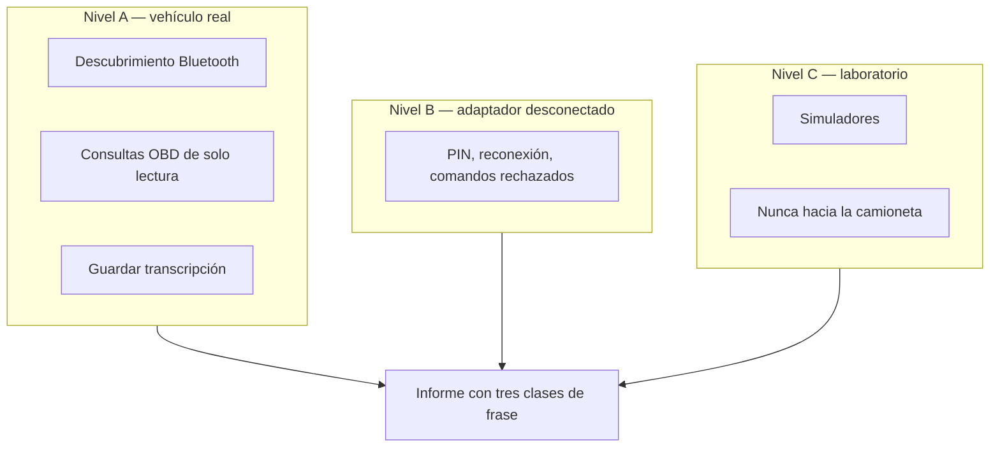

# JAC T8 — diagnóstico de solo lectura y evaluación de seguridad

Evaluación del **11 de noviembre de 2026** sobre una JAC T8 estacionada, con un ELM327 Mini Bluetooth y un Xiaomi. No es una certificación ISO/SAE 21434 ni UNECE R155. Es un procedimiento reproducible: medir, guardar la respuesta cruda y separar la falla técnica de la ciberseguridad.

**App actual: JAC Diagnostic Lab 1.1.0.** APK para dueño o mecánico: [release v1.1.0](https://github.com/cherrera0001/jac-diagnostic-lab/releases/tag/v1.1.0) (`jac-diagnostic-lab-1.1.0-debug.apk`). Sin ELM327 no hay lectura nueva; sí sirve el ciclo de taller y un PDF ya guardado.

El informe de la medición no se versiona. Queda solo en el equipo donde se generó.

## Cómo está armado



| Carpeta | Qué es |
|---|---|
| [jac-diagnostic-lab](jac-diagnostic-lab/) | Aplicación Android. Habla con el vehículo. |
| [c4a-automotive-security](c4a-automotive-security/) | Inventario, amenazas, hallazgos y el informe. No transmite al vehículo. |

La app solo envía una lista cerrada de consultas. No borra códigos, no reprograma y no mueve actuadores. Otra aplicación del teléfono sí podría hablar directo con el adaptador: el filtro vive en esta app, no en el dongle.

## Cómo se usa

Condición: camioneta **estacionada**, freno de mano puesto, contacto en **ON**. No circular con la app conectada. El dueño empieza en **Hoy** (ocho pasos). El mecánico usa **Monitor** (medidores + antes/después) y **Taller** (ciclo de siete pasos).



1. Freno de mano puesto. Contacto en ON. No mover la camioneta y no pisar el acelerador para probar.
2. El aparato va en el enchufe de diagnóstico, debajo del volante. El emparejamiento se hace en Ajustes de Android. Si el sistema pide PIN, se escribe ahí. Esta app no lo pide ni lo guarda.
3. Cerrar OBD Auto Doctor u otra app de diagnóstico. El aparato atiende a un solo cliente.
4. En **Hoy**, pulsar **4. Permitir Bluetooth**.
5. Pulsar **5. Leer la camioneta**. Dejar el teléfono junto al aparato, con la pantalla abierta, cerca de un minuto.
6. Leer solo lo que dice el paso 6. Traduce los números que conoce. No dice qué pieza cambiar.
7. Ir a **Copia** y pulsar **PDF del informe**. El archivo se arma en ese momento, no durante la lectura. JSON y TXT son la copia cruda. CSV solo sale si hubo sensores. Si no hay contenido, el botón no escribe y, si Android ya creó el archivo, se borra. La huella SHA-256 del PDF queda en un archivo `.sha256` al lado cuando se guarda desde Hoy.
8. Sacar el aparato. Llevar el PDF a un servicio de la marca y pedir que lean los mismos números sin borrarlos.

Si el teléfono ya tiene una lectura guardada, **Hoy** abre en el paso 6 para armar el informe sin enchufar de nuevo.

Son ocho trabajos, no ocho programas. El que revisa no es el que lee: tú detienes y enchufas; el teléfono mantiene la pantalla; el aparato solo pasa bytes; la computadora del motor es la única que contesta; la lectora traduce y no borra; el contraste separa lo medido, lo genérico y lo que el fabricante no publicó para esta unidad; el revisor no cierra una causa ni un ataque con esa sola lectura; el taller confirma con su escáner.

### Qué significan las pantallas

| Pestaña | Para qué sirve | Qué no hace |
|---|---|---|
| Hoy | Los ocho pasos de la lectura, el resultado en palabras y el PDF | No recomienda cambiar piezas |
| Monitor | Medidores en orden (RPM, velocidad, refrigerante, carga, mariposa, MAP, APP, ATRV) y capturas antes/después | No inventa un PID de freno; ATRV no es la batería |
| Taller | Ciclo del mecánico: leer sin borrar → medir → ajustar → comparar → decidir circulación | No borra DTC ni prueba el corte en marcha |
| Avisos | Códigos, hipótesis y validaciones de seguridad | No da un porcentaje ni certifica la camioneta |
| Copia | PDF / JSON / TXT / CSV (solo si hay contenido) | No crea un archivo vacío ni sube nada a internet |

**Copia** puede anonimizar el identificador del vehículo y la dirección Bluetooth. **Hoy** no escribe esos datos en el PDF. El informe de una unidad concreta sigue fuera de este repositorio.

## Proceso de funcionamiento

Cada ciclo tiene tres niveles. Solo el A toca la camioneta.



| Clase de frase | Cuándo se usa |
|---|---|
| Medido | Hay archivo de la sesión, con hora y respuesta cruda |
| Documental | Sale de un manual o de una norma, y se dice que no se midió en esta unidad |
| Desconocido | No hay archivo ni fuente aplicable a esta camioneta |

Reglas del ciclo:

1. Vehículo estacionado. Nada de pruebas en movimiento.
2. Lista cerrada de comandos. `ATZ` reinicia el intérprete del adaptador. El servicio `04`, que borra códigos, está bloqueado.
3. `NO DATA` no significa “sin fallas”. Una conexión exitosa no autoriza a circular.
4. Los síntomas EPC y de potencia van a la línea técnica. No se llaman ciberataque sin una evidencia distinta.
5. El laboratorio de `c4a-automotive-security/lab/` no se conecta al transporte Bluetooth real.

Compilar y probar, desde `jac-diagnostic-lab`, con JDK 21:

```text
gradlew.bat :app:testDebugUnitTest :app:assembleDebug
```

Instalar la APK debug con el teléfono desbloqueado:

```text
adb install -r dist\jac-diagnostic-lab-debug.apk
```

## Cómo se construye

El trabajo nuevo entra por [specs/PROCESO.md](specs/PROCESO.md): requisito numerado, decisión en `adr/`, prueba que nombra el requisito, y después el código. La exportación está en [specs/001-exportacion/spec.md](specs/001-exportacion/spec.md) y [ADR-001](adr/ADR-001-el-archivo-se-arma-al-pulsar.md).

## Versión

La serie de cambios de software está en [CHANGELOG.md](CHANGELOG.md). La app informa `versionName` 0.6.0 (`versionCode` 5). Los resultados de una unidad concreta no forman parte de este archivo.
