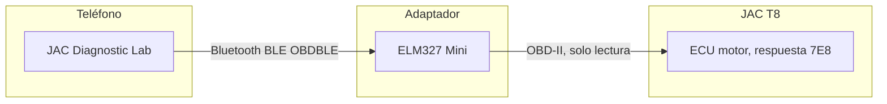
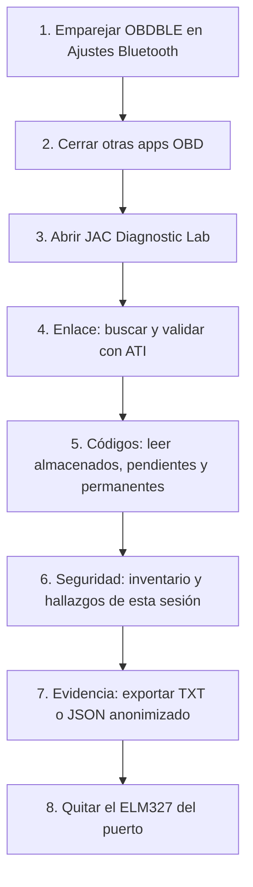
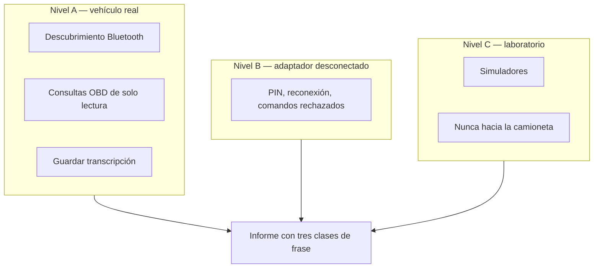

# JAC T8 — diagnóstico de solo lectura y evaluación de seguridad

Evaluación del **11 de noviembre de 2026** sobre una JAC T8 estacionada, con un ELM327 Mini Bluetooth y un Xiaomi. No es una certificación ISO/SAE 21434 ni UNECE R155. Es un procedimiento reproducible: medir, guardar la respuesta cruda y separar la falla técnica de la ciberseguridad.

El informe de la medición no se versiona. Queda solo en el equipo donde se generó.

## Cómo está armado



| Carpeta | Qué es |
|---|---|
| [jac-diagnostic-lab](jac-diagnostic-lab/) | Aplicación Android. Habla con el vehículo. |
| [c4a-automotive-security](c4a-automotive-security/) | Inventario, amenazas, hallazgos y el informe. No transmite al vehículo. |

La app solo envía una lista cerrada de consultas. No borra códigos, no reprograma y no mueve actuadores. Otra aplicación del teléfono sí podría hablar directo con el adaptador: el filtro vive en esta app, no en el dongle.

## Cómo se usa

Condición: camioneta **estacionada**, freno de mano puesto, contacto en **ON**. No circular con la app conectada.



1. En el teléfono, emparejar el adaptador. Si Android pide PIN, se escribe en el diálogo del sistema. Esta app no lo pide ni lo guarda.
2. Cerrar OBD Auto Doctor u otra app OBD. El adaptador suele aceptar un solo cliente.
3. Abrir **JAC Diagnostic Lab** y conceder Bluetooth si lo pide.
4. Pestaña **Enlace**. Buscar. Elegir **OBDBLE** si no aparece **OBDII**. Validar con ATI. Tiene que verse una identificación del adaptador antes de seguir.
5. Pestaña **Códigos**. Leer almacenados, pendientes y permanentes. No hay botón para borrarlos.
6. Pestaña **Seguridad**. Muestra lo verificado en esta sesión y lo que sigue desconocido. No muestra un porcentaje de seguridad.
7. Pestaña **Evidencia**. Exportar JSON o TXT con la anonimización activada.
8. Desconectar en la app y **retirar el adaptador** del puerto OBD-II.

La pestaña **Análisis** separa síntomas del conductor y bytes leídos. Un síntoma no condena una pieza. **Sensores** solo lee PID que la ECU declaró soportados.

### Qué significan las pantallas

| Pestaña | Para qué sirve | Qué no hace |
|---|---|---|
| Enlace | Encontrar OBDII o OBDBLE y abrir la sesión | No demuestra que el dongle sea original |
| Códigos | Mostrar DTC tal como llegaron | No traduce el texto SAE J2012-DA |
| Sensores | RPM, temperatura, carga, velocidad, acelerador, colector, si el mapa los incluye | No mide el interruptor de freno |
| Evidencia | Guardar la transcripción en el teléfono | No sube nada a internet |
| Análisis | Hipótesis de la falla, con lo que falta | No recomienda cambiar piezas |
| Seguridad | Hallazgos y amenazas con evidencia | No certifica el vehículo |

## Proceso de funcionamiento

Cada ciclo tiene tres niveles. Solo el A toca la camioneta.



| Clase de frase | Cuándo se usa |
|---|---|
| Medido | Hay archivo de la sesión, con hora y respuesta cruda |
| Documental | Sale de un manual o de una norma, y se dice que no se midió en esta unidad |
| Desconocido | No hay archivo ni fuente aplicable a esta camioneta |

Reglas del ciclo:

1. Vehículo estacionado. Nada de pruebas en movimiento.
2. Lista cerrada de comandos. `ATZ` reinicia el intérprete del adaptador. El servicio `04`, que borra códigos, está bloqueado.
3. `NO DATA` no significa “sin fallas”. Una conexión exitosa no autoriza a circular.
4. Los síntomas EPC y de potencia van a la línea técnica. No se llaman ciberataque sin una evidencia distinta.
5. El laboratorio de `c4a-automotive-security/lab/` no se conecta al transporte Bluetooth real.

Compilar y probar, desde `jac-diagnostic-lab`, con JDK 21:

```text
gradlew.bat :app:testDebugUnitTest :app:assembleDebug
```

Instalar la APK debug con el teléfono desbloqueado:

```text
adb install -r dist\jac-diagnostic-lab-debug.apk
```

## Versión

La serie de cambios de software está en [CHANGELOG.md](CHANGELOG.md). La app informa `versionName` 0.1.0. Los resultados de una unidad concreta no forman parte de este archivo.
