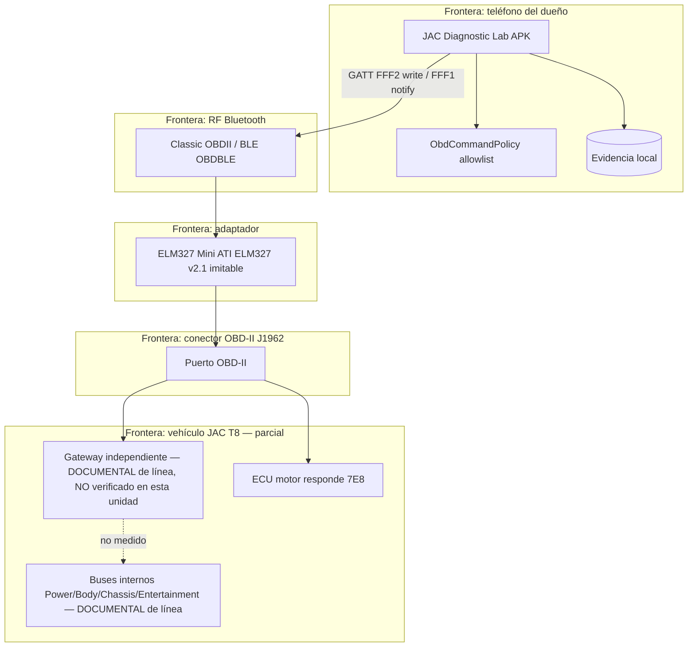

# Arquitectura y flujo de datos — Nivel A

Conceptual. Componentes marcados **DESCONOCIDO** no están medidos en esta unidad.

## Límites de confianza medidos vs desconocidos

| Límite | Estado |
|---|---|
| App → adaptador (BLE) | MEDIDO (sesión 2136-8803) |
| Adaptador → ECU vía OBD genérico | MEDIDO (`0100`, `03`) |
| OBD → buses propietarios / gateway | DESCONOCIDO en esta unidad |
| Autenticación frente a 3.er dispositivo | NO MEDIDO |

## Separación Nivel A / B / C

- **Nivel A:** solo `jac-diagnostic-lab` + allowlist. Vehículo estacionado.
- **Nivel B/C:** código bajo `c4a-automotive-security/lab/`. No enlazado al transporte real del vehículo.
