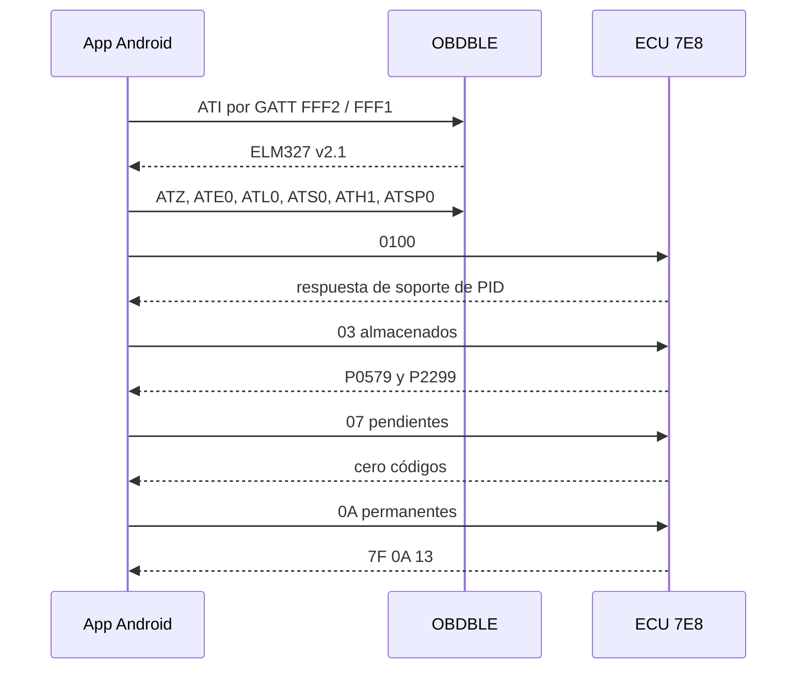

# Informe de evaluación — JAC T8

**Identificador:** C4A-AUTO-INFORME-2026-11-11  
**Fecha de la medición:** 11 de noviembre de 2026, 21:36 hora local  
**Versión del corte:** v0.2.0  
**Quién encarga:** dueño del vehículo y responsable de la evaluación  
**Piezas usadas:** JAC T8 (declarada por el dueño), ELM327 Mini Bluetooth, Xiaomi 2512BPNDAG con Android 17, app JAC Diagnostic Lab

## 1. Posición

La ECU del motor respondió por OBD-II y guardó dos códigos, P0579 y P2299. Esos códigos describen, en la norma pública SAE J2012, un conflicto entre el circuito de freno o crucero y el pedal del acelerador. Esa es la línea técnica que hay que medir ahora, con multímetro y con un escáner JAC, sin borrar la memoria.

No hay evidencia de que un tercero haya adulterado el freno o el acelerador. Tampoco hay evidencia de que el vehículo esté libre de fallas, ni de que sea seguro circular. Esta evaluación no certifica la camioneta.

## 2. Alcance

Se midió el camino Bluetooth del adaptador y las consultas OBD-II de solo lectura, con el vehículo estacionado y el contacto en ON.

Quedó fuera, y se declara desconocido en esta unidad: año, versión comercial, motor, transmisión, firmware de ECU, gateway, multimedia y telemática. Un manual de la línea T8 2018–2022 menciona un gateway independiente. Eso no se comprobó en esta camioneta.

No se envió el servicio `04`. No se barrieron identificadores CAN. No se hicieron pruebas en movimiento.

## 3. Cómo se llegó al dato

La transcripción cruda está en `jac-diagnostic-lab/evidence/captured/session-2026-11-11T2136-8803.txt`.

## 4. Hechos medidos

| Pregunta | Respuesta | Confianza | Fuente |
|---|---|---|---|
| ¿El adaptador habla Bluetooth Low Energy? | Sí. Nombre OBDBLE. Escritura y notificación en el servicio FFF0 | Alta | Sesión 2136-8803 |
| ¿Qué identidad reporta? | El texto `ELM327 v2.1` | Media | ATI y ATZ. El texto se puede copiar |
| ¿Qué protocolo quedó tras hablar con la ECU? | ISO 15765-4, CAN de 11 bit a 500 kbit/s, número A6 | Alta | ATDP y ATDPN después de `0100` |
| ¿La ECU contestó? | Sí, identificador de respuesta 7E8 | Alta | Trama de `0100` |
| ¿Hay códigos almacenados? | P0579 y P2299 | Alta | Modo `03` |
| ¿Hay códigos pendientes? | La ECU informó cero | Alta | Modo `07` |
| ¿Hay códigos permanentes? | No se pudieron leer. Respuesta negativa `7F 0A 13` | Alta | Modo `0A` |
| ¿El MIL genérico está encendido? | No | Alta | PID `0101` |
| ¿Eso apaga el EPC? | No. El EPC no es ese bit | Alta | Definición del PID, no una medición del tablero |
| ¿Tensión del adaptador? | 16,9 V estimados por ATRV | Baja como medición de batería | ATRV no reemplaza un multímetro |
| ¿Se borraron códigos? | No | Alta | La política bloquea `04` y la transcripción no lo contiene |

Pruebas de la aplicación, rerun forzado el mismo día: 25 pruebas, 0 fallos (`ProtocolTest` 15, `SecurityPolicyTest` 6, `ObdCommandPolicyTest` 4). Eso valida el software. No valida la camioneta.

APK debug de ese corte: SHA-256 `A37FEDF39F488744FB71986D54F9794A3B5C4234B8780A4C46E295A98B21A4C2`, 12 061 995 bytes, en `jac-diagnostic-lab/dist/`.

## 5. Lectura técnica de los códigos

La app no trae el catálogo SAE J2012-DA y no inventa el texto en pantalla. Este informe usa la definición pública de esos dos números, marcada como documental:

- **P0579.** Circuito de entrada multifunción del control de crucero, fuera de rango o de rendimiento. En servicio suele involucrar el interruptor de freno o de cancelación.
- **P2299.** Posición de freno incompatible con la posición del acelerador. La ECU ve freno aplicado y pedal de acelerador fuera del umbral al mismo tiempo.

El reporte del conductor (EPC, aviso de motor, pérdida de potencia al frenar, alivio al rearrancar) encaja con esa estrategia de limitación de par. Encajar no identifica la pieza.

| Hipótesis | A favor | En contra | Falta |
|---|---|---|---|
| Interruptor de freno en desacuerdo | P0579, P2299 y el relato del freno | Nada eléctrico medido todavía | Tensiones del interruptor, reposo y pisado, contacto en ON |
| Pedal de acelerador electrónico | P2299 | No hay cruce simultáneo freno/acelerador en esta sesión | Dos pistas del pedal, comparadas con la tabla del motor de esta unidad |
| Masa o alimentación | Un conflicto de pedales a veces nace ahí | ATRV en 16,9 V no alcanza para afirmarlo ni para descartarlo | Caída en masas con instrumento independiente |
| Accesorio intercalado en el arnés | Sería adulteración física de la señal | No se inspeccionó el conector | Mirar el camino del pedal hasta la ECU |
| Tercero inyectando CAN o firmware alterado | Nada medido | Tampoco se demostró lo contrario | Otra evidencia: firmware comparado, o una sesión que no sea la del dueño |

El cuadro congelado crudo fue `7E8054202000579`. El resumen automático que lo llamó P0005 no se usa como hallazgo. Hay que releerlo con un escáner que muestre los bytes del PID `02` del modo `02`.

## 6. Seguridad del camino de diagnóstico

Hallazgos con archivo. El detalle JSON está en `c4a-automotive-security/reports/findings/`.

| ID | Qué quedó demostrado | Qué no |
|---|---|---|
| C4A-AUTO-2026-001 | Tras conectar, el perfil BLE aceptó comandos AT | No se probó un segundo teléfono no emparejado |
| C4A-AUTO-2026-002 | `ELM327 v2.1` no prueba un adaptador original | Procedencia real del hardware |
| C4A-AUTO-2026-003 | La lista blanca protege solo a esta app | Otra app puede abrir el mismo dongle |
| C4A-AUTO-2026-004 | El OBD genérico es alcanzable desde Bluetooth | Buses internos de esta unidad |
| C4A-AUTO-2026-005 | Hay DTC almacenados. Es falla técnica | No es un exploit |
| C4A-AUTO-2026-006 | El gateway de esta unidad no se midió | No se afirma ni se niega filtrado OBD |

Amenazas T-001 a T-010 están modeladas en el código y en `c4a-automotive-security/docs/tara/TARA-2026-11-11.md`. El riesgo residual del acceso Bluetooth de un extraño sigue desconocido hasta una prueba con un segundo teléfono propio, un solo intento, vehículo estacionado.

## 7. Qué hacer ahora

En este orden, sin borrar códigos y sin probar el fallo en la calle:

1. Quitar el ELM327 cuando no se esté diagnosticando.
2. Con contacto en ON y el vehículo inmovilizado, medir el interruptor de freno y las dos pistas del acelerador.
3. Leer los mismos códigos y el freeze frame en un escáner JAC. Anotar bytes. No ejecutar borrado.
4. Si aparece un módulo que no es de fábrica en el arnés del pedal, tratarlo como adulteración física y retirarlo antes de otra prueba.
5. Si las señales de fábrica ya están en desacuerdo, es reparación de componente o de ajuste, no un incidente cibernético.
6. No circular mientras el corte de potencia al frenar siga presente. Eso es un riesgo de conducción.

## 8. Límites de este informe

- Una conexión exitosa no es una vulnerabilidad y no es un permiso para circular.
- La ausencia de códigos pendientes no es ausencia de falla.
- El rechazo del modo `0A` no demuestra que todos los servicios estén protegidos.
- No se declara cumplimiento de ISO/SAE 21434, ISO 26262 ni UNECE R155.
- Las pruebas automáticas cubren la app. El laboratorio adversarial todavía es un esqueleto y no se ejecutó contra el vehículo, a propósito.
